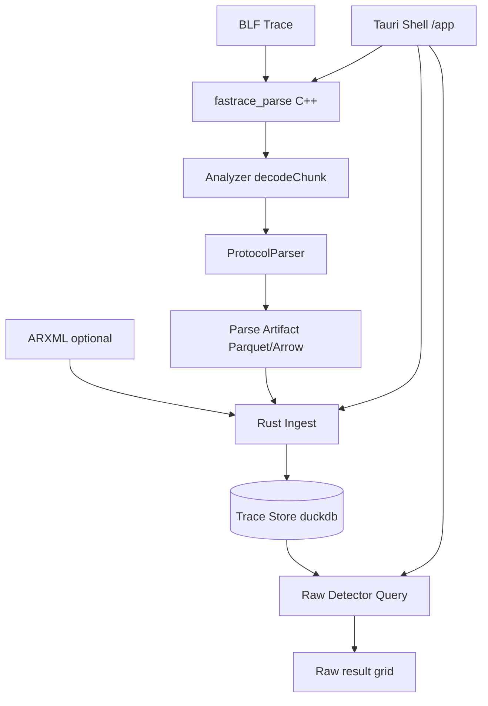

# Query-based anomaly detection rework

Domain language: [`CONTEXT.md`](../../CONTEXT.md).

## Locked decisions

- **Shell = Tauri** under [`/app`](../../app) (React + TypeScript). **Delete Qt `/ui` immediately** in this work; no dual UI.
- **Hard cutover**: remove streaming [`DetectionEngine`](../../cpp/src/DetectionEngine.cpp) and [`cpp/detectors/*`](../../cpp/detectors/). Query path only.
- **Parse ≠ Ingest**:
  - **C++ Sidecar** (`fastrace_parse`): BLF → structured records fast (Analyzer + ProtocolParser peel). **No DuckDB in C++.**
  - **Rust / Shell**: Ingest Parse Artifact (+ optional ARXML) into DuckDB **Trace Store**; run Detector Queries.
- **Handoff**: on-disk **Parquet / Arrow IPC** (v1). Streaming later.
- **Prepare Trace Store**: one user action (Parse → Ingest). Always re-runs when clicked (no fingerprint skip in v1). Optional ARXML materialised into store when provided.
- **Fail-fast**: Prepare error → abort; no successful half-written `*.duckdb`.
- **Detector Query**: user-composed **raw SQL**; results shown as **raw columns/rows**. Detection-shaped UI / navigate-to-message **deferred**.
- **No payload BLOBs** in Trace Store — C++ expands/peels into SQL-friendly columns; opaque bytes are not useful in SQL.
- **After Prepare**, Detector Queries must not reopen the BLF (or ARXML file).
- **Observability (v1)**: Shell UI / logs only — no `pipeline_*` tables yet.
- **Parse Artifact**: kept on disk; **manual delete** control in UI (not auto-deleted on success).
- **Local-only** desktop; no server/fleet DB.

## Architecture

## Components

| Piece | Owns |
|-------|------|
| `fastrace_parse` | C++ CLI: parse BLF, peel protocols, write Parse Artifact beside Trace (e.g. `<stem>.parse.parquet`) |
| `/app` Tauri Shell | UI + orchestration; spawn sidecar; Rust DuckDB ingest; SQL editor/runner; artifact delete |
| Trace Store | `<blf_stem>.duckdb` — messages, `protocol_*`, optional `arxml_*`, `meta` |
| Detector Query | Ad-hoc SQL in Shell against Trace Store |

C++ keeps [`ProtocolParser`](../../cpp/src/ProtocolParser.cpp) as the peel (enrich over time for FR parity — e.g. fuller SOME/IP-SD entry fields). Product path does **not** register C++ `Detector` subclasses.

### Trace Store schema (v1 direction)

Structured, detection-oriented columns (exact DDL during implement):

- `messages` — msg_id, timestamp_us, channel, addrs/ports, lengths, file_offset, … (no payload BLOB)
- `protocol_pdu` / `protocol_someip` / `protocol_someip_sd` / `protocol_doip` — peeled headers / entries as columns
- `arxml_*` when Signal Database provided at Prepare
- `meta` — schema_version, source paths, prepare timestamps

**Not in v1 store:** `detections` table as product contract, `pipeline_runs` / `pipeline_events`, payload BLOBs.

### User loop (all manual)

1. **Prepare Trace Store** — pick Trace (+ optional ARXML) → sidecar parse → Rust ingest → DuckDB (fail-fast).
2. **Compose Detector Query** — raw SQL editor.
3. **Run** — execute SQL → raw result grid.
4. **Delete Parse Artifact** — explicit UI action when desired.

### Parse Sidecar contract (sketch)

- Input: BLF path (flags as needed).
- Output: Parquet/Arrow dataset with tables aligned to Trace Store ingest.
- Exit non-zero on Error; Shell aborts Prepare and cleans incomplete DuckDB.
- No SQL execution; no DuckDB writes.

### Shell (v1 UI surface)

- File pickers: Trace, optional ARXML.
- Prepare button + progress/error log.
- SQL editor + Run + result table (arbitrary columns).
- Controls to delete Parse Artifact / manage Trace Store file.
- **Out of v1 UI:** message list/timeline parity, click-to-navigate, Detection filters/stats, continuous detect.

## Removal / cutover

- Delete [`/ui`](../../ui) (Qt `fastrace_ui`).
- Stop compiling DetectionEngine, `cpp/detectors/*`; strip from [`cpp/CMakeLists.txt`](../../cpp/CMakeLists.txt).
- Retarget docs/AGENTS away from Qt UI → `/app` + `fastrace_parse`.
- Update [`cpp/doc/query_store_architecture.md`](../../cpp/doc/query_store_architecture.md) to match Parse/Ingest split (retire “C++ embeds DuckDB” / coexistence wording).
- Add Speckit feature dir (e.g. `specs/007-query-anomaly-pipeline/`).

## Delivery order

1. **Cutover cleanup** — remove Qt UI + streaming detectors from the product build (or same PR train as Shell scaffold so the tree isn’t UI-less longer than needed—**product decision is delete Qt now**).
2. **Parse sidecar** — `fastrace_parse` writes Parquet/Arrow from Analyzer + ProtocolParser.
3. **Tauri `/app` + Rust ingest** — Prepare Trace Store into DuckDB; fail-fast; UI progress/logs.
4. **SQL console** — raw editor, run, raw grid; manual artifact delete.
5. **Docs** — architecture + specs; FR-016–032 mapped to required peel columns / example SQL in a later pass.

## Out of scope (v1)

- Fingerprint skip / silent reuse of Trace Store
- Streaming parse→ingest handoff
- Detection DTO UI, navigate/peek, severity filters
- DuckDB `pipeline_*` persistence / OpenTelemetry
- Payload BLOBs in DuckDB
- Continue-on-error / quarantine
- Live append while BLF grows
- Server/fleet DBs
- Qt coexistence

## Success criteria

- Prepare on testdata BLF (+ optional ARXML) produces `*.duckdb` with message/protocol (+ arxml) rows; BLF not required for subsequent SQL.
- Prepare Error → Failed in UI/logs; no successful half Trace Store.
- User writes/runs arbitrary SQL against Trace Store; raw grid shows returned columns.
- Parse Artifact remains until user deletes it in UI.
- `fastrace_parse` does not link DuckDB; Shell does not parse BLF.
- Qt `/ui` and DetectionEngine / `*Detector` gone from product build.
