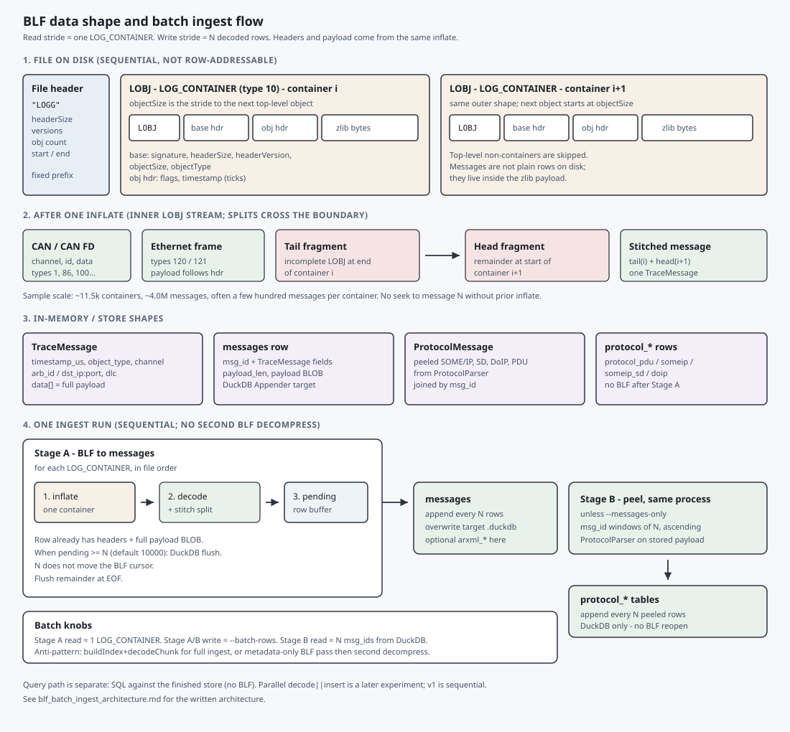

# BLF structure and batch ingest architecture

How a Vector BLF is laid out on disk, and how fastrace should read it in batches and write those batches into an analytical store (DuckDB in the current POC).

- Diagram: [`images/blf_structure_and_ingest.svg`](images/blf_structure_and_ingest.svg)
- Parallel decompress pipeline (UI / throughput path): [`design.md`](design.md)
- POC tooling / locked product-vs-POC choices: [`poc_blf_duckdb_ingest.md`](poc_blf_duckdb_ingest.md)
- Types: [`../include/BlfTypes.h`](../include/BlfTypes.h), [`../include/TraceMessage.h`](../include/TraceMessage.h)

## Diagram



## BLF file structure

A BLF is a **sequential stream of sized records**, not a random-access message table.

```
[ BlfFileHeader "LOGG" ] [ LOBJ ] [ LOBJ ] ... [ LOBJ ]
```

### File header

`BlfFileHeader` starts with signature `"LOGG"`, then sizes, versions, object counts, and measurement start/end times. After `headerSize` bytes, the first top-level log object begins.

### Top-level LOBJ

Every top-level object starts with `BlfObjectHeaderBase`:

| Field | Role |
|-------|------|
| `signature` | `"LOBJ"` |
| `headerSize` / `headerVersion` | How much header follows |
| `objectSize` | **Byte stride to the next top-level object** |
| `objectType` | Discriminator (e.g. `LOG_CONTAINER = 10`) |

A type-1 object header (`BlfObjectHeader`) adds flags and a timestamp (tick units depend on flags).

### Where the messages actually are

Most traffic lives inside **`LOG_CONTAINER` (type 10)** objects:

1. Outer LOBJ headers (as above).
2. A **zlib-compressed** payload (`objectSize` minus headers).
3. After inflate: a second sequential stream of **inner** LOBJs — `CAN_MESSAGE`, `CAN_FD_*`, `ETHERNET_FRAME` / `ETHERNET_FRAME_EX`, env vars, etc.

Implications:

- There is **no** stable “seek to message index N” without scanning/inflating earlier containers.
- One container typically holds on the order of **hundreds** of messages (varies by capture). A large drive file may have ~10k+ containers and millions of messages.
- An inner LOBJ can **split** across two containers: incomplete **tail** at the end of container *i*, remainder **head** at the start of container *i+1*. Those fragments must be stitched before decode.

Top-level non-container objects are skipped for message ingest (or handled separately if needed).

## Data shapes

| Shape | Where | Contents |
|-------|--------|----------|
| Compressed container | BLF | zlib bytes inside `LOG_CONTAINER` |
| Inner LOBJ | After inflate | Wire structs from `BlfTypes.h` |
| `TraceMessage` | Memory | Unified ts/channel/ids + `data` payload ([`TraceMessage.h`](../include/TraceMessage.h)) |
| `messages` row | DuckDB | `msg_id` + TraceMessage fields + **`payload` BLOB** |
| `ProtocolMessage` | Memory | Peeled SOME/IP, SD, DoIP, PDU ([`ProtocolMessage.h`](../include/ProtocolMessage.h)) |
| `protocol_*` rows | DuckDB | Peeled columns, joined by `msg_id` |

After Stage A completes, anomaly SQL and hex inspection can use the store **without reopening the BLF** (POC choice: keep full payload blobs).

## Recommended batch read / write

Use **two different batch units**. Do not drive the BLF cursor by “read N rows.”

| Stage | Read batch | Write batch |
|-------|------------|-------------|
| **A — BLF → `messages`** | **One `LOG_CONTAINER`** | Accumulate rows; flush every **N** (`--batch-rows`, default 10 000) |
| **B — store → `protocol_*`** | **N** `msg_id`s from DuckDB (ascending) | Flush peeled rows every **N** |

### Stage A (single BLF walk)

```
mmap BLF
overwrite / create DuckDB; CREATE messages (+ meta [, arxml_*])
pending = []
for each LOG_CONTAINER in file order:
    inflate
    decode inner LOBJs (+ stitch split with previous/next container)
    append TraceMessage rows to pending   # headers + full payload together
    while pending.size() >= N:
        DuckDB append first N rows
        drop flushed rows from pending
flush remaining pending
```

Why this is correct:

- Matches the file’s natural compression boundary.
- Headers and payload come from the **same** inflate (no “metadata-only” pass then a second decompress).
- Split LOBJs stay ordered: container *i* then *i+1* with stitch.
- **N only controls DuckDB flush size**; it does not seek inside the BLF.

### Stage B (same process, no BLF)

Default path after Stage A (skipped with `--messages-only`):

```
CREATE protocol_* tables
for msg_id windows [lo, hi) of size N, ascending:
    SELECT columns + payload FROM messages
    rebuild TraceMessage → ProtocolParser::parse
    append protocol_* rows
```

Ascending `msg_id` keeps stateful TCP reassembly in `ProtocolParser` correct.

### What not to do for full ingest

- **`buildIndex` + `decodeChunk` as the full-ingest loop** — correct for UI random access; pays an index pass plus a second inflate for every chunk.
- **Arbitrary row count as the BLF read stride** — forces whole-container inflate anyway and fights split handling.
- **Two BLF passes** (“extract metadata”, then “extract compressed blobs”) — doubles decompress work; metadata and bytes are produced together per container.
- **Shuffled peel order** — breaks DoIP/TCP state in Stage B.

## Relationship to the parallel parser

[`design.md`](design.md) describes a **producer / multi-consumer** pipeline that overlaps mmap I/O with parallel container inflate for throughput and UI indexing. That design remains valid for decode speed (`Analyzer`).

For **batch ingest into DuckDB**, the POC uses a separate sequential reader — [`BlfIngestReader`](../include/BlfIngestReader.h) — so `Analyzer` / `decodeChunk` stay untouched for the UI path. Stage A is inflate → decode → buffer → append; the **read batch remains one container**. A later experiment can reintroduce decode∥insert overlap on top of this surface.

## Query after ingest

`fastrace_query` (POC) runs SQL against the finished DuckDB file: SQL on stdin, results on stdout, timing on stderr. It does not read the BLF.

## References

- Wire types: [`../include/BlfTypes.h`](../include/BlfTypes.h)
- Decode / stitch implementation: [`../src/Analyzer.cpp`](../src/Analyzer.cpp)
- Split-object notes: [`split_object_designs.md`](split_object_designs.md)
- Product query-store target (Rust Trace Store): [`query_store_architecture.md`](query_store_architecture.md)
