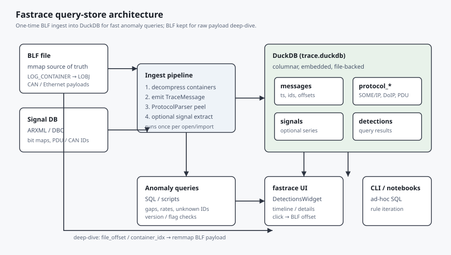
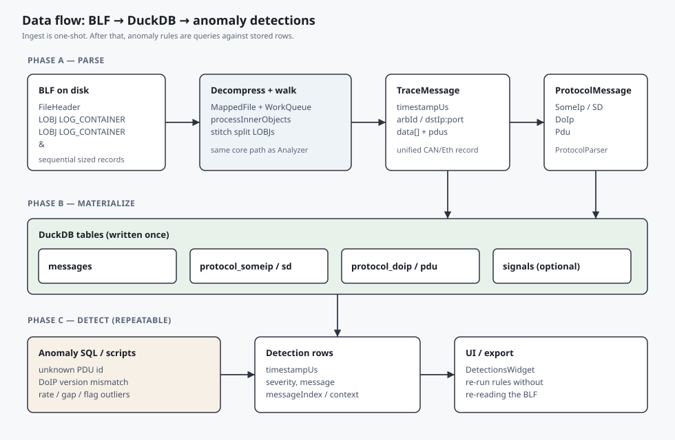

# Query-store architecture for anomaly detection

This document describes the **target** storage architecture for fast, queryable anomaly detection over automotive traces.

For BLF layout and batch read/write, see [`blf_batch_ingest_architecture.md`](blf_batch_ingest_architecture.md). For the temporary C++-embedded DuckDB timing POC, see [`poc_blf_duckdb_ingest.md`](poc_blf_duckdb_ingest.md).

It complements the existing BLF parse design in [`design.md`](design.md) and the streaming detector model in `specs/006-anomaly-detection/`. The current `DetectionEngine` walks `decodeChunk` in memory; this design adds a **one-time ingest** into an embedded analytical store so anomaly rules can be iterated without re-parsing the BLF.

## Goals

- Ingest a BLF **once** into a separate, fast query store.
- Detect anomalies by **querying records** (SQL / scripts), not only by a single streaming pass.
- Keep the original BLF as the **payload source of truth** for deep-dive and lossless re-decode.
- Fit a desktop analyzer (embedded store, no required server).

## Non-goals

- Replacing mmap/`ChunkEntry` lazy UI browse (that path can stay).
- Shipping a multi-tenant server database as the default local backend.
- Storing every raw payload blob in SQL as the primary representation.

## Architecture overview



### Components

| Piece | Role |
|-------|------|
| **BLF file** | Append-only log of compressed `LOG_CONTAINER` objects holding CAN/Ethernet LOBJs. Remains authoritative for raw bytes. |
| **Signal DB (ARXML/DBC)** | Maps CAN IDs / Ethernet PDU locations to named signals. Used during ingest for optional signal tables and for “unknown ID” checks. |
| **Ingest pipeline** | Reuses Analyzer-class parsing: decompress containers → `TraceMessage` → `ProtocolParser` → rows. Runs once per import. |
| **DuckDB (`trace.duckdb`)** | File-backed analytical store next to the trace. Columnar scans + window functions for anomaly rules. |
| **Anomaly queries** | SQL/scripts that emit `Detection`-shaped results. |
| **UI / CLI** | Consume detection rows; jump back into BLF via stored offsets when needed. |

### Why DuckDB

For single-trace, desktop analysis:

- Embedded (no daemon), one file beside the BLF.
- Fast full-table / range scans and window functions (`LAG`, rates, gaps).
- Cheap to re-run or tweak rules after ingest.
- SQLite remains fine for a thin metadata index only; it is weaker for analytical anomaly SQL. Server stores (Timescale/ClickHouse) are reserved for future fleet-scale use.

## Data flow



### Phase A — Parse (same domain objects as today)

```
BLF → MappedFile → LOG_CONTAINER inflate → LOBJ walk
  → TraceMessage (ts, channel, arbId / dst, data, pdus, …)
  → ProtocolParser → ProtocolMessage (SomeIp / SomeIpSd / DoIp / Pdu)
```

BLF itself is a **sequence of sized records**, not a linked list: each LOBJ’s `objectSize` is the stride to the next object. Containers nest a second sequential LOBJ stream after decompression (see [`design.md`](design.md)).

### Phase B — Materialize (one-time)

Write detector-ready tables. Suggested minimum schema:

**`messages`**

| Column | Notes |
|--------|--------|
| `msg_id` | Stable row id / global message index |
| `timestamp_us` | Series key |
| `channel`, `object_type` | Filter / grouping |
| `arb_id`, `extended_id` | CAN |
| `dst_ip`, `dst_port` | Ethernet |
| `file_offset`, `container_idx` | Jump back into BLF |
| `payload_ref` | Prefer offset/hash over inlining large blobs |

**`protocol_someip` / `protocol_someip_sd` / `protocol_doip` / `protocol_pdu`**

Peeled headers so anomaly SQL does not re-implement `ProtocolParser`. Stateful TCP DoIP reassembly should happen **during ingest**; store complete DoIP messages.

**`signals` (optional)**

`(timestamp_us, signal_id, raw_value [, phys_value])` sorted/partitioned for chart and threshold queries.

**`detections`**

Persisted findings: `timestamp_us`, `detector_name`, `severity`, `message`, `message_index`, `context…` — aligned with `Detection` in `cpp/include/Detection.h`.

### Phase C — Detect (repeatable, cheap)

Example rule classes that map well to SQL:

| Rule | Query idea |
|------|------------|
| Unknown PDU ID | `protocol_pdu` ⟕ ARXML PDU set → missing |
| Invalid DoIP version / inverse | Predicate on stored header fields |
| Unexpected SOME/IP-SD flags | Filter on `flags` |
| High frequency / gaps | Window over `(id, timestamp_us)` |
| Missing alive / session quirks | Prefer ingest-time state machine **or** ordered SQL with careful session keys |

Emit rows into `detections` (or return them directly to the UI model).

## Relation to the current streaming engine

| Concern | Current (`DetectionEngine`) | Query-store path |
|---------|-----------------------------|------------------|
| Input | `Analyzer::decodeChunk` stream | Pre-materialized DuckDB tables |
| Detectors | C++ `Detector::inspect` | SQL / scripts (+ optional C++ helpers) |
| Re-run cost | Re-decode chunks | Scan/query store only |
| Stateful TCP / SD | Parser + detector merge | Prefer resolve at ingest, store flat rows |
| UI wiring | `MainWindow::runDetectors` | Same `Detection` shape; swap backend later |

Both can coexist: streaming for quick first-pass / live progress; DuckDB when the user wants interactive rule iteration on a fully ingested trace.

## Retrieval performance guidelines

1. **Index / sort** `messages` and protocol tables by `timestamp_us`; secondary keys on `arb_id`, `pdu_id`, `service_id` as needed.
2. **Do not** make full payload BLOBs the hot path — keep BLF + offsets.
3. **Ingest cost ≈ one full decode** (same order as today’s detector pass). Amortize by reusing the DB across rule edits.
4. For UI message list / timeline, either query `messages` for the visible window or keep the existing chunk index; use DuckDB primarily for **anomaly and analytics** queries.

## Implementation sketch (not yet landed)

1. Add an ingest API (e.g. `TraceStore::ingest(Analyzer&, path)`) that walks chunks and bulk-inserts into DuckDB.
2. Register SQL (or script) detectors that read the store and append `Detection`s.
3. Optionally cache `trace.duckdb` keyed by BLF path + mtime so reopening skips ingest.
4. Keep deep-link: detection `message_index` / `file_offset` → existing details views.

## References

- [`design.md`](design.md) — BLF container pipeline, stitcher
- [`../include/TraceMessage.h`](../include/TraceMessage.h) — unified message row
- [`../include/ProtocolMessage.h`](../include/ProtocolMessage.h) — peeled protocol variants
- [`../include/DetectionEngine.h`](../include/DetectionEngine.h) — current streaming orchestrator
- `specs/006-anomaly-detection/` — product/data-model for detections
