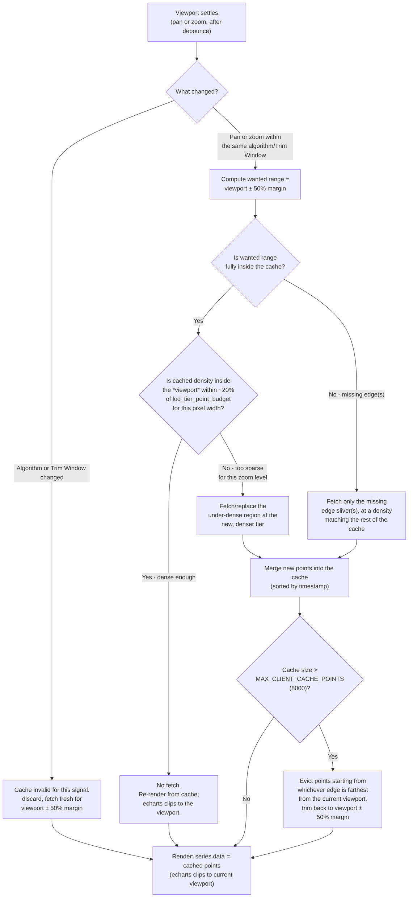

# 0011. Frontend point cache for Timeline pan and zoom

- Status: Decisions 1-6 superseded by `docs/adr/0012` (the extent+density
  cache model here had two bugs in practice: the cache's recorded extent
  only ever grew, so coverage checks went stale forever after the first
  fetch, and a dense sub-region could mask a sparse one in the aggregate
  density check. 0012 replaces it with a fixed-grid tile cache). Decision
  7 (Anomaly Overlay stays out of scope, viewport-exact, no cache) still
  stands.
- Date: 2026-11-24

## Plain-language summary

Today, every time the Timeline chart's viewport settles after a pan or
zoom, the frontend throws away whatever points it already had and asks
the backend for a brand new set, scoped exactly to the new viewport. That
sounds reasonable, but in practice it means almost every mouse-wheel tick
(the main way you pan/zoom this chart) fires a fresh backend call per
displayed signal, plus one for the Anomaly Overlay - and because the old
data isn't kept around while the new fetch is in flight, the chart visibly
flashes empty each time.

The fix: stop treating every settle as "forget everything, ask again."
Keep a local cache of points per signal, sized at roughly the limit of
what the backend already downsamples a Trim Window down to (~8000 points -
comfortably within what echarts can render). Panning within what's
already cached costs nothing. Panning to the edge of it only fetches the
*new* sliver of time you've moved into, not the whole visible range again.
Zooming still gets you more detail where it matters, but only when the
cache genuinely doesn't have enough detail for where you've zoomed to -
not just because the zoom level number changed.

## Context

`docs/adr/0009` made the backend recompute a Downsampling
Algorithm result for the exact current viewport on every pan/zoom
settle (debounced). That solved the original problem (static bins, a
thin anomaly invisible at low zoom) but overshot for the common case:

- The dominant interaction is mouse-wheel pan/zoom (`zoomOnMouseWheel:
  "ctrl"`, `moveOnMouseWheel: true`). Wheel ticks are naturally spaced
  further apart than the debounce window, so the debounce rarely
  coalesces anything - nearly every tick becomes its own fetch.
- Each settle fans out to one fetch per displayed signal plus one for
  the Anomaly Overlay.
- No previous data is retained while a new fetch is in flight
  (`placeholderData`/`keepPreviousData` was never configured), so every
  one of those fetches is visible as a flash.
- The backend's own Trim-Window-scoped LOD fetch already produces a
  point count (observed ~8000) that echarts renders without strain.
  Re-deriving a *different* downsampled set for every small pan inside
  that same Trim Window is optimizing a problem the first LOD pass
  already solved.

## Decision

1. **A per-(signal, Downsampling Algorithm) point cache lives in the
   frontend**, not keyed to the exact viewport like today's React Query
   key. It tracks the time range it currently covers and the points in
   it.
2. **Pan is served from cache whenever possible.** On settle, the
   "wanted" range is the viewport padded by 50% of the viewport's own
   span on each side (so the wanted range is 2x the viewport's width,
   centered on it). If the cache already covers the wanted range, no
   fetch happens - echarts just re-renders using already-cached points,
   clipped to the new viewport by its own axis/dataZoom mechanics. If
   the wanted range only partially overlaps the cache, only the missing
   edge sliver(s) are fetched and merged in - never the whole visible
   range again.
3. **Zoom is served from cache only if the cache is already dense
   enough there.** A changed pixel-width/tier number is not by itself a
   reason to fetch: it's only a reason once the *density* of
   already-cached points inside the new viewport falls meaningfully
   short (more than ~20%) of what `lod_tier_point_budget(pixel_width)`
   (`docs/adr/0009`) says that viewport's span is owed. When that's
   true, the under-dense region is treated like a gap and
   fetched/replaced at the new, denser tier - gap-filling alone isn't
   enough here, because the region is technically "covered," just too
   sparse for the zoom level you're now at.
4. **The cache is capped at `MAX_CLIENT_CACHE_POINTS` (8000,
   `config/config.json`) per signal.** Whenever a merge would push the
   cache over the cap, points are evicted starting from whichever edge
   is farthest from the current viewport, trimming back toward the
   viewport-plus-50%-margin window. This cap is deliberately the same
   kind of number as the backend's own per-viewport LOD budget
   (`docs/adr/0009`) - it is not a new resolution ceiling, it is what
   decides when "wider cache, lower density" has gone far enough and
   needs trimming back.
5. **A changed Downsampling Algorithm or a new Trim Window invalidates
   and rebuilds a signal's cache from scratch.** Points fetched under a
   different algorithm, or outside the current Trim Window, mean
   nothing in the new context.
6. **LTTB's seam artifact at a merge boundary is accepted, not
   engineered around.** Min/Max buckets a time range independently, so
   stitching two adjacently-fetched Min/Max chunks together is sound as
   long as bucket edges are computed consistently. LTTB is not
   composable the same way - its point selection is a holistic pass
   over its own input range (each picked point depends on the previous
   pick and the next bucket's centroid), so two separately-fetched LTTB
   chunks stitched at a boundary can show a visible kink right at the
   seam. This is a known, visual-only limitation for v1. If it proves
   unacceptable in practice, the fix is a targeted recompute of the
   boundary region, not a redesign of the cache.
7. **The Anomaly Overlay is explicitly out of scope.** Its fetch is one
   small SQL aggregate (a bin count), not a bulk point transfer, so the
   "don't destroy what you already fetched" problem this ADR solves
   doesn't apply to it. It keeps its existing behavior: viewport-exact,
   debounced, recomputed on every settle (`docs/adr/0009`).

## Flow

## Considered Options

- Pre-fetch adjacent tiles proactively on top of the cache, so a pan
  that's about to cross a boundary never has to wait: rejected for v1 -
  it is a latency/UX polish on top of this mechanism, not the problem
  being solved (the problem is "stop destroying and re-fetching data
  you already have"), and adds its own tuning surface (which direction
  to prefetch, how far ahead). Revisit if the gap-fill fetch latency
  itself proves noticeable.
- Apply the same cache-and-evict treatment to the Anomaly Overlay:
  rejected - its payload is a handful of bins, not thousands of points,
  so there's nothing expensive being thrown away on every settle.
- Engineer LTTB's merge boundary to be seamless (e.g., always refetch
  a window wide enough to re-run LTTB over the whole cache plus the new
  delta, every time): rejected for v1 as unnecessary cost for an
  accepted visual-only defect; revisit only if it proves disruptive in
  practice.

## Consequences

- Panning within an already-cached region is now free (no backend
  call), which directly removes the fetch-per-wheel-tick and
  flash-on-every-settle behavior this ADR was written to fix.
- Zooming still gets denser data exactly when the cache can't already
  provide it - the density check (`decision 3`) is what prevents this
  cache from regressing the original anomaly-visibility problem
  `docs/adr/0009` was written to solve.
- LTTB signals can show a visible seam at a merge boundary. Documented
  and accepted (`decision 6`), not hidden.
- The cache and its eviction/merge logic add real state and real pure
  logic to test (gap detection, density comparison, merge, eviction) -
  this is new surface area, tracked the same way the rest of the LOD
  pipeline's pure helpers are (`docs/adr/0009`'s `lttb_downsample`,
  `shouldShowDots`, etc.): small, independently testable functions, not
  logic buried inside the React component.

## Revisit when

- Wheel-tick-driven fetch frequency is still a problem even with the
  cache in place (e.g., because the viewport itself is being resized
  dramatically every tick) - likely needs the prefetch option above.
- An LTTB merge seam is reported as visually disruptive, not just
  cosmetically imperfect - the fix is a targeted recompute of the
  boundary region (`decision 6`), not a redesign.
- `MAX_CLIENT_CACHE_POINTS = 8000` turns out too small (visible
  under-density even at stable zoom) or too large (echarts render cost
  becomes noticeable) once exercised on a real large Trace.
