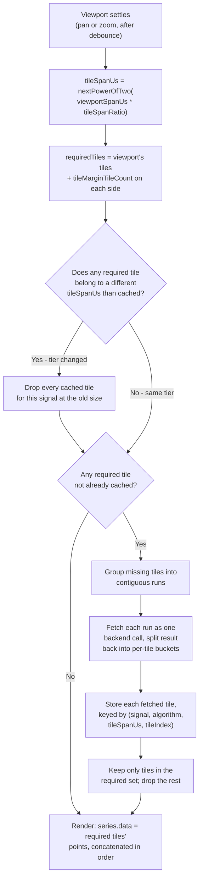

# 0012. Frontend tile cache for Timeline pan and zoom

- Status: Accepted
- Date: 2026-11-25
- Supersedes: `docs/adr/0011` decisions 1-6 (Anomaly Overlay, decision 7,
  is unaffected and stays as-is)

## Plain-language summary

`docs/adr/0011`'s cache tracked one growing time range per signal, plus
whatever points it had fetched into that range. In practice this broke in
two ways: the range only ever grew wider, so after the very first fetch
the cache claimed to cover almost everything forever, and a small region
that had been fetched at high detail could, just by having a lot of
points, make a much wider region look "detailed enough" even though most
of it was still coarse. Expanding the zoom after zooming in once would
then show stale, coarse data and never ask the backend for more.

The fix: stop tracking one fuzzy range. Split time into fixed **tiles**,
the same idea game engines use for terrain (a camera doesn't trigger one
mesh update per frame - it loads whichever fixed terrain tiles are near
it, drops the ones that are too far, and swaps the whole tile set when it
crosses into a different zoom band). A tile is either fully loaded or not
loaded - never partially filled, never merged with another tile's data.
"Do we have enough?" becomes "do we have every required tile?", which is
a simple yes/no per tile, not a range comparison or a point count.

## Context

`docs/adr/0011`'s implementation shipped and was tested, but the user's
own exploratory testing surfaced it going stale: zoom to a small range
(works - the cache's density check correctly detects it's too sparse and
fetches more), then expand the zoom (fails - the cache claims the wider
range is still "covered" because its tracked extent only ever grew via
`Math.min`/`Math.max`, and the old dense sub-region inflates the
aggregate point count enough to pass the density check for the new,
wider viewport). See `docs/adr/0011`'s own text for the full original
design; this ADR replaces its mechanism, not its goals (ADR-0011's
Context - fetch-per-wheel-tick, flash-on-every-settle - still applies and
is still the problem being solved).

A follow-up question during review: if each tile is one backend fetch,
doesn't a wide margin need many small fetches? Game engines avoid this by
sizing tiles so only a small, fixed number are ever visible at once (a
few rings around the camera, not one tile per pixel), and by loading a
newly-needed ring in one request, not one request per unit of distance.
This ADR's tile size follows the same rule: it is pegged to the current
viewport's own span, not to a small fixed duration, so there are always
roughly 3 tiles per signal in view (center + one margin tile on each
side), and multiple missing tiles that are contiguous are still fetched
as a single coalesced backend call.

## Decision

1. **Tile size tracks the current zoom level, snapped to a stable band.**
   `tileSpanUs = nextPowerOfTwo(viewportSpanUs * tileSpanRatio)`
   (`tileSpanRatio`, `config/config.json`, default `1.0`). Snapping to a
   power of two means small pan/zoom jitter doesn't constantly re-grid -
   the tile size only changes when the viewport's span crosses a
   power-of-two boundary, the same stability property
   `lod_tier_point_budget` already has (`docs/adr/0009`).
2. **Tiles sit on a fixed grid, not centered on the viewport.**
   `tileIndex = floor(timestampUs / tileSpanUs)`. A tile's bounds are
   `[tileIndex * tileSpanUs, (tileIndex + 1) * tileSpanUs)`. Because the
   grid is fixed (not re-centered every settle), a tile fetched once is
   trivially reusable by a later pan that happens to revisit it - no
   extent math, just a key lookup.
3. **The required tile set is the viewport's tiles plus a margin of
   whole tiles on each side**: `tileMarginTileCount` tiles
   (`config/config.json`, default `1`) beyond whatever tiles the viewport
   itself overlaps. Panning within the margin costs nothing; panning past
   it needs only the newly-entered tile(s).
4. **A tile is cached whole or not at all**, keyed by
   `(signalId, algorithm, tileSpanUs, tileIndex)`. Missing tiles that are
   contiguous are fetched as one backend call spanning their combined
   range and then split back into individual tile buckets by timestamp -
   this is the "coalesce contiguous misses into one request" rule from
   the Context, kept from ADR-0011's gap-fill, just applied to whole
   tiles instead of arbitrary slivers.
5. **A zoom that crosses into a different tile size drops every tile at
   the old size for that signal and fetches fresh tiles at the new
   size.** There is no merging across tile sizes - exactly one tile size
   is live per signal at a time, so there is nothing for a stale extent
   or an uneven density to hide behind.
6. **Eviction is a set-membership filter, not a trim.** Every settle,
   each signal's cache keeps exactly the required tile set (decision 3)
   at the current tile size and discards everything else - tiles from a
   previous tile size, or tiles outside the current margin window. No
   sorting, no point-array splicing, no cap to tune (`MAX_CLIENT_CACHE_POINTS`
   from ADR-0011 is gone - the cap is now implicitly "how many tiles are
   required," which is always small and bounded by `tileMarginTileCount`).
7. **LTTB's merge-boundary seam is still accepted, not engineered
   around** (unchanged from ADR-0011 decision 6) - it can now only occur
   at a tile boundary, which is at least a fixed, predictable location
   instead of wherever a previous gap-fetch happened to end.
8. **The Anomaly Overlay is still out of scope** (unchanged from ADR-0011
   decision 7) - it stays viewport-exact, debounced, recomputed on every
   settle, no cache.

## Flow

## Considered Options

- Keep ADR-0011's extent+density model and patch the two bugs directly
  (stop seeding from the Trim-Window-wide bootstrap viewport; shrink the
  extent on a partial densify): rejected - the underlying problem is that
  "coverage" was represented as a fuzzy range plus a point count, which
  has no good way to represent "this part is dense, that part isn't"
  without re-adding exactly the complexity a tile grid gives for free.
  Patching it would still leave a model that's hard to reason about.
- One tile per signal covering the whole Trim Window at every tier
  (i.e. no tiling, always refetch everything on any viewport change):
  rejected - this is the original fetch-storm problem ADR-0011 was
  written to fix, just renamed.
- Tiles sized as a small fixed duration (e.g. a fixed number of
  microseconds) regardless of zoom level: rejected - at a wide zoom this
  means hundreds of tiles and backend calls for one viewport; at a narrow
  zoom it wastes tiles smaller than a pixel. Pegging tile size to the
  viewport's own span keeps the live tile count roughly constant (around
  3) at every zoom level, which is what makes the "many small calls"
  concern a non-issue.

## Consequences

- Coverage is now a simple question ("is tile N in the map?") instead of
  a range comparison plus a density heuristic - this is what fixes both
  bugs found in ADR-0011's model, structurally, not by patching the
  symptom.
- Memory/render cost is bounded by tile count, not a point cap to tune -
  `tileMarginTileCount` is the only knob, and it is a small integer with
  an obvious meaning ("how many extra tiles to keep ready").
- A tier change (zoom crossing a tile-size boundary) discards and
  refetches every tile for that signal, same cost as ADR-0011's "zoom
  that fails the density check" path - no regression there.
- LTTB's seam artifact (ADR-0011 decision 6) still applies, now at tile
  boundaries specifically.

## Revisit when

- `tileSpanRatio` or `tileMarginTileCount` need tuning once exercised on
  a real large Trace (too many small calls at one value, too much
  over-fetch at another).
- A tier change's full discard-and-refetch is visibly disruptive - the
  fix would be prefetching the new tier's tiles before dropping the old
  ones, not a redesign of the tile model.
