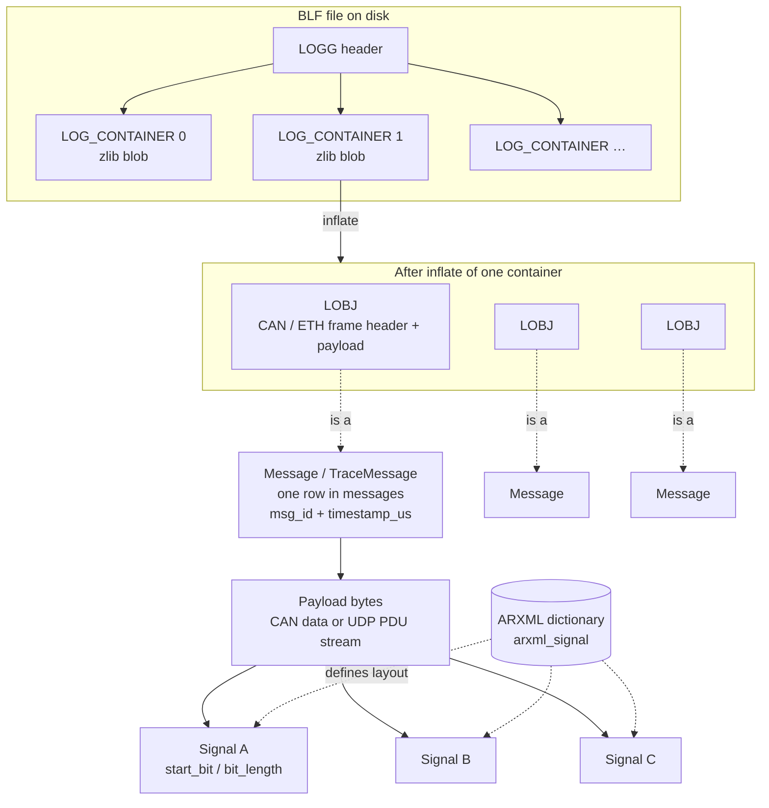

# BLF object model: container, LOBJ, message, signal

Vocabulary matches [`GLOSSARY.md`](../GLOSSARY.md). Layout narrative: [`ingestion-pipeline.html`](ingestion-pipeline.html).

## Cardinalities

| From → To | Relation |
|---|---|
| Container → LOBJ | **1 : N** — one compressed blob holds many LOBJs |
| LOBJ ↔ Message | **1 : 1** — same thing; LOBJ is the BLF wire object, Message is the in-memory / store row |
| Message → Signal samples | **1 : 0..N** — a message carries zero or more signals (per ARXML parent); each decoded value is one `signals` row |
| Signal def → Messages | **1 : many over time** — same `signal_id` appears whenever its parent CAN id / PDU is seen |

**One-liner:** Container wraps LOBJs; each LOBJ *is* a Message; Signals are bit-fields *inside* that message’s payload, laid out by ARXML — not separate BLF objects.
